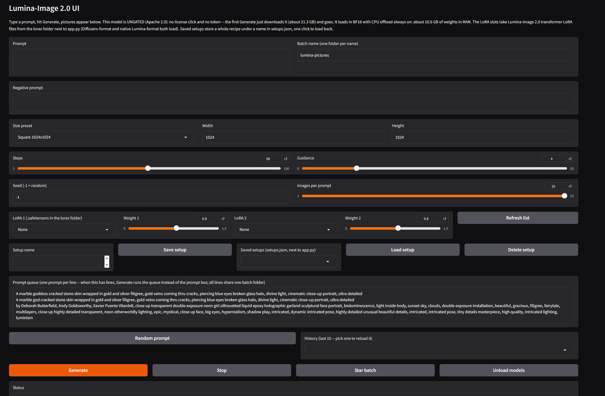
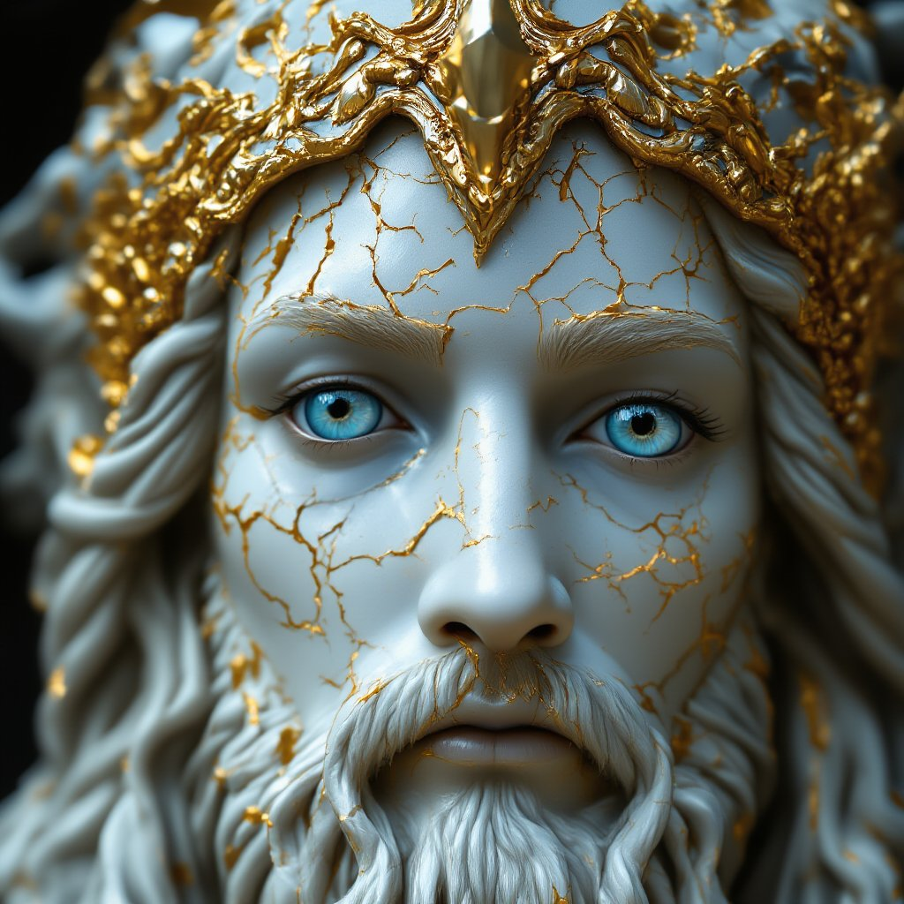

# Lumina-Image 2.0 UI

*The app: one page, type a prompt, hit Generate. Defaults shown — Square 1024x1024, 50 steps, guidance 4.0. No token box anywhere — the model is ungated.*

## Before you start

- **Python: nothing to install.** Python 3.12 is included in this package, in the `python_embeded` folder, ComfyUI portable style. If you have **Python 3.10** (or any other Python) for other apps, it is left completely alone and is not needed here — Diffusers 0.42 dropped Python 3.10, which is why this app carries its own 3.12.
- **This model is UNGATED — there is no license click and no token.** Lumina-Image 2.0 is Apache 2.0 on Hugging Face: the app has **no token box**, passes no token, and the first Generate just downloads. If any guide tells you to accept a license or create a token for this model, it is out of date — the repo's own API record says `gated: False`.
- A Windows PC with an NVIDIA graphics card (12 GB VRAM is the design target), about **25 GB free disk space**, and an internet connection.
- The first Generate downloads the model weights: **21,253,711,141 bytes (about 21.3 GB)** — measured, not estimated: the build's download-scope bench recorded the exact file set the loader obtains (17 files). The repo's headline size is 31.72 GB, but 10.44 GB of that is a duplicate `consolidated.00-of-01.pth` at the repo root (the transformer weights again in PyTorch format) which the Diffusers pipeline loader never requests, plus a 22.6 MB demo image it likewise never fetches.
- **Status: PC proven.** This build was installed and proven on the author's PC (RTX 4070 12 GB, 16 GB RAM) on Nov 1, 2026: a first single image, then a three-line prompt queue with a 10-image batch per line — 31 frames at 1024x1024 / 50 steps, all in one session, no silent exit, no out-of-memory, at about 42 seconds per image under CPU offload.

**Lumina-Image 2.0, without Jupyter and without Colab.**

Lumina-Image 2.0 is Alpha-VLLM's 2.6B-parameter diffusion transformer with a Gemma-2 text encoder — a model with a strong reputation for prompt alignment and rendered text — wrapped in the same plain app shape as the rest of this family: run it, a page opens in your browser, type a prompt, pictures appear. Free forever. Apache 2.0 model, no account, no gate.

## Example renders

All rendered with this app on an RTX 4070 12 GB, 1024x1024, 50 steps, guidance 4.0, Nov 1, 2026.

*Marble goddess — the first picture this build ever rendered (frame 000001, seed 52563452). Prompt: "A marble goddess cracked stone skin wrapped in gold and silver filigree, gold veins coming thru cracks, piercing blue eyes broken glass halo, divine light, cinematic close-up portrait, ultra detailed"*

*Marble goddess, same prompt, from the 10-image proof batch (frame 000005, seed 294567235).*

*Marble god — the god variant of the same prompt family (frame 000014, seed 957784633).*

*Neon double exposure (frame 000022, seed 247806309) — bioluminescent double-exposure portrait prompt (Butterfield / Goldsworthy / Vilardell style string), run as a 10-image queue line.*

*Neon double exposure, same queue line (frame 000027, seed 298444727).*

## What it does

- Text-to-image generation on your own GPU — no cloud, no account, no token anywhere in the app
- Prompt + negative prompt (real classifier-free guidance — negatives genuinely steer), steps slider with a type-in box (default **50**), guidance slider with a type-in box (default **4.0**) — the model card's own worked-example values
- The card's CFG shape is fixed in the app, deliberately not a knob: `cfg_trunc_ratio=0.25` (guidance stops partway through the run, the card's setting) and `cfg_normalization=True`; prompts are capped at the pipeline's 256-token default (the pipeline internally prefixes its trained system prompt — you type plain prompts)
- CPU offload is **always on** — there is no off switch, because the BF16 weight set does not fit usefully in 12 GB of VRAM all at once
- Two LoRA slots with weight sliders (0.0–1.5, default 0.8) — Lumina-Image 2.0 **transformer** LoRA files (.safetensors) dropped in the `loras` folder; see **LoRAs** below for the honest format limits
- Saved setups — a whole recipe (prompt, negative, steps, guidance, size, seed, batch name, LoRA picks) stored under a name in `setups.json` and loaded back in one click; see **Saved setups** below
- Size presets (Square 1024x1024 — the house default, Small square 768, Portrait 768x1024, Landscape 1024x768) plus custom width/height boxes (sizes snap to a multiple of 16, the pipeline's real rule)
- Up to 10 pictures per prompt — rendered as separate single calls, one after another, never a batched call — each with its own seed, saved as 000001.png, 000002.png, and so on
- Seed shown in the status line (-1 = random; a fixed seed S gives S, S+1, S+2, ... across a multi-image run)
- A Random prompt button (word banks built in, no list file), and a session-only prompt history dropdown (last 10)
- A Stop button to cancel a run, and Star batch to copy a batch into images_out/favorites/
- A prompt queue (one prompt per line — when it has lines, Generate runs the queue instead of the single prompt box, all lines sharing the one batch folder, frames numbered continuously, one settings.txt block appended per finished line — stop mid-queue and every finished line's frames AND settings survive, so the resume point is exact)
- Dynamic prompts: {a|b|c} groups, one random pick per group, re-expanded for every single image (prompt and negative prompt). settings.txt records the expanded prompt actually used
- An Unload models button to free VRAM and RAM, and memory freed between every image in a run (long queues keep working)
- Every run adds its pictures to the batch folder and appends a block to `settings.txt` next to them (date, time, frame range, model, dtype, offload, size, steps, guidance, cfg values, LoRA state, prompt, negative prompt, expanded prompts, seeds)

No animation, no upscaling, no editing, no ControlNet, no inpainting, no img2img — v1 is text-to-image only, kept simple on purpose.

## LoRAs

Diffusers 0.42's Lumina2 pipeline genuinely supports LoRAs — the pipeline carries `Lumina2LoraLoaderMixin`, and this build verified the support against the wheel and with a real adapter A/B test (see Code verification). Two slots, each with a weight slider (0.0 to 1.5, default 0.8 — 0.8 to 1.0 is the usual working range; lower is subtler, higher is stronger and can start to fight the prompt).

1. Drop `.safetensors` LoRA files into the `loras` folder. It sits **next to app.py, inside the `lumina-ui` subfolder** of the app folder (the folder that holds `run.bat` has a `lumina-ui` folder inside it; `app.py` and `loras` are in there).
2. Pick a file in the **LoRA 1** / **LoRA 2** dropdowns — hit **Refresh list** after adding a file while the app is running — set the weights, and Generate. `None` in a slot means no LoRA in that slot. (Known family quirk: a file added mid-session occasionally does not appear even after Refresh list — restarting the app always picks it up.)
3. Each run's `settings.txt` block records what was applied, e.g. `loras: my-style.safetensors @ 0.8`. Switching the picks between runs unloads the old adapters first, so a LoRA never leaks from one run into the next.

**The honest format limits.** The Lumina2 loader's only loadable module is the **transformer** (`_lora_loadable_modules == ["transformer"]`) — the Gemma text encoder never takes a LoRA, so an encoder-only LoRA file matches zero modules and is a **failed load** in this app, surfaced as a plain status message, never a silent render without the LoRA. **Diffusers-format** files load as-is, and **native Lumina-format** files (keys starting `diffusion_model.`) are converted by the loader itself — both shapes are accepted. A file whose keys contain no `lora` at all is refused by the loader with its own error. LoRAs built for other models (SDXL, SD 1.5, FLUX, ...) do not work here.

## Saved setups

One compact row under the LoRA row: type a name in the **Setup name** box and click **Save setup**; later, pick the name in the **Saved setups** dropdown and click **Load setup** to restore the whole recipe into the controls in one click. **Delete setup** removes the picked one; saving over an existing name replaces it, and the status line says so.

A setup captures: prompt, negative prompt, steps, guidance, size (preset plus custom width/height), seed, batch name, and both LoRA picks with their weights. Setups persist in `setups.json` next to `app.py` (created on the first save, readable by hand) and survive restarts; a code-only app.py swap does not touch it. If a setup names a LoRA file that is no longer in `loras/`, that slot loads as None and the status line names the missing file. (There is no token in this app, so there is nothing secret for a setup to leak.)

## Requirements

- Windows, an NVIDIA GPU (12 GB VRAM is the design target), and a recent driver
- Python 3.12 is bundled in the `python_embeded` folder: no Python install, no PATH changes, no venv — your other Pythons are left completely alone, and this app lives entirely in this folder
- Disk space: about 25 GB free for the first download (21.3 GB of weights), plus room for pictures
- System RAM — the honest part. With CPU offload, the weights live in **system RAM** while one component at a time uses the GPU. The repo ships float32 files; the app loads in **bfloat16** (the model card's own load), halving the resident set:
  - **About 10.6 GB of weights resident** — the transformer about 5.2 GB, the Gemma-2 text encoder about 5.2 GB, the VAE about 0.2 GB — plus working headroom (activations, the image being built, Gradio itself).
  - On a **16 GB RAM** machine that fits, with a few GB to spare for Windows and the browser — expect it to work, snugly; close other big apps for long queues. On 32 GB or more it is roomy. (For contrast, a float32 load would be about 21 GB resident and would not fit 16 GB at all — the BF16 load is what makes this model a 16 GB citizen.)

## Install

1. Extract the whole zip somewhere plain, like `C:\AI\lumina` — the folder holding `install.bat` is the app folder.
2. Double-click `install.bat` and wait — it sets up pip inside the bundled Python, then installs PyTorch with CUDA plus the packages into it. Run it again if anything interrupts it; it resumes where it stopped.
3. Double-click `run.bat`. A page opens in your browser. Type a prompt, hit Generate. No token, no license step — the first Generate downloads the model (about 21.3 GB) and then renders.

install.bat does NOT need re-running for code-only updates: if only app.py changed, just replace the file (in the inner `lumina-ui` folder) and run run.bat again.

## First test

1. Leave everything at the defaults — Square 1024x1024, 50 steps, guidance 4.0 — and hit Generate.
2. The first run downloads the model (about 21.3 GB), so it takes a while — that is the one-time download, not a stuck render. Loads after that are minutes; per-image render time on the author's 12 GB card under offload measured about 42 seconds at 50 steps square (50 steps is the card's full-quality setting; 30 steps — the pipeline's own default — is the faster try if a render feels slow).
3. If a load fails, the status line says so in plain language: this model is ungated, so the cause is the download or the machine (a dropped connection resumes where it left off — just Generate again; not enough free RAM — close other big apps).
4. A `torch_dtype` deprecation warning from transformers may print in the console during load on this pinned stack. It is a warning only; the load completes.
5. The three proofs that made this build "proven" on the author's machine — one single image; a small queue of a few lines; a batch of more than three images at 1024x1024, all in one session, no silent exit, no out-of-memory — make a good first session on yours too.

## Where pictures go

`images_out/` next to `run.bat`, one subfolder per batch name (default `lumina-pictures`), reused across runs — repeat runs with the same batch name add pictures to the same folder, numbered continuously (`000001.png`, `000002.png`, ...), so nothing is ever overwritten. `settings.txt` in the folder grows by one block per finished queue line (date, time, frame range, model, dtype, offload, size, steps, guidance, cfg_trunc_ratio, cfg_normalization, max sequence length, LoRA state, prompt, negative prompt, expanded prompts, seeds). Starred batches land in `images_out/favorites/`.

## How it works

Diffusers 0.42.0, Lumina2Pipeline — one load shape, the model card's own:

1. `Lumina2Pipeline.from_pretrained("Alpha-VLLM/Lumina-Image-2.0", torch_dtype=torch.bfloat16)` — a single whole-pipeline load, no per-component preloading, no quantization, no dtype cast beyond the card's BF16 (the repo ships float32 files; BF16 halves the resident size to about 10.6 GB). No token is passed, ever: the repo is ungated.
2. `enable_model_cpu_offload()` is called **always** — components park in system RAM and move to the GPU one at a time. The pipeline's components are the Lumina2 transformer (2.61B params), a Gemma-2 text encoder (2.61B params), and the FLUX-configuration VAE.
3. The pipeline call is `pipe(prompt, negative_prompt, height, width, num_inference_steps=<steps>, guidance_scale=<guidance>, cfg_trunc_ratio=0.25, cfg_normalization=True, max_sequence_length=256, generator)` with one CPU generator per image (seeded from the seed box), one call per image. The CPU generator is deliberate: it is the family pattern under offload, PC-proven in the sibling apps. Sizes snap to a multiple of 16 before the call — the real pipeline rejects anything else (`vae_scale_factor × 2`), so the UI makes the rejection unreachable.
4. LoRAs load through the pipeline's own adapter API: each picked file loads once per Generate click with `load_lora_weights(<loras folder>, weight_name=<file>, adapter_name="lora<i>")`, then one `set_adapters(names, adapter_weights=weights)` applies both slots' weights; changing the picks unloads first with `unload_lora_weights()`. The API is PEFT-backed — that is why `peft` is pinned in requirements.txt.
5. The tokenizer is Gemma's: in the pinned transformers (5.20.2), `GemmaTokenizer` **is** `GemmaTokenizerFast` — one unified tokenizers-backed class loading the repo's `tokenizer.json`. There is no sentencepiece slow path in this stack, which is why requirements.txt deliberately pins **none** of sentencepiece / protobuf / tiktoken (each omission is backed by a blocked-import control in bench 1 — the T5 chain that needed those pins in sibling apps is not this model's chain).

## Code verification (no GPU in the build environment)

- `app.py` compiles clean (`py_compile`), and the real Gradio page builds against the pinned gradio 5.50.0: no radio, no checkbox, **no token box of any kind** (the repo is ungated), the card defaults on the controls (50 steps, guidance 4.0, Square 1024x1024, batch `lumina-pictures`), both LoRA dropdowns present, all nine buttons wired (bench 5: 20/20 checks).
- **Tokenizer bench (bench 1: 13/13)** — the real load the first Generate depends on, run in a pristine venv built from this bundle's own requirements.txt, against the model's own tokenizer files downloaded from the repo: AutoTokenizer loads (vocab 256,000), encode/decode round-trips, fast and slow names agree. Dependency-chain controls: with protobuf + tiktoken imports blocked, the tokenizer still loads (the Chroma failure shape cannot occur here); with sentencepiece imports blocked, it still loads — because in transformers 5.20.2 `GemmaTokenizer is GemmaTokenizerFast`, one unified class with no sentencepiece path. A guard fails if sentencepiece, protobuf, or tiktoken is ever pinned in requirements.txt without new evidence.
- **Weight-key audit (bench 2: 13/13)** — without downloading 21 GB: each component's real config + safetensors index plus every shard's safetensors header fetched by HTTP range request, against the real model classes instantiated from those configs on the meta device: transformer (459 tensors), Gemma text encoder (288 tensors), and VAE — **0 missing keys, 0 unexpected keys, 0 shape mismatches** everywhere; all dtypes float32; parameter totals × 4 bytes equal each index total exactly (transformer 2,609,769,152 params; text encoder 2,614,341,888; VAE 83,819,683).
- **Real check_inputs bench (bench 3: 11/11)** — Lumina2Pipeline assembled from tiny real components (tiny transformer/VAE/Gemma with the real geometry — `vae_scale_factor` 8 — the real tokenizer, and the repo's real scheduler values): the real signature defaults are pinned (30 steps, guidance 4.0, cfg_trunc_ratio 1.0, cfg_normalization True, max_sequence_length 256), the real `check_inputs` accepts the app's exact call pattern, and rejects — with the real error texts — a height that breaks the divide-by-16 rule, a prompt-plus-embeds call, and max_sequence_length 513.
- **Forward + LoRA bench (bench 4: 10/10)** — the standing family rule after the SD 3.5 Large FP8 miss: never ship a load-only proof when a forward is reachable. Here a full tiny forward IS CPU-reachable (plain BF16 model — no cast, no quantization): a tiny end-to-end pipeline call through the real code with the app's exact kwargs (cfg_trunc_ratio 0.25, cfg_normalization True, max_sequence_length 256, negative prompt) produces an image, reproduces it exactly at the same seed, and runs with an empty negative. A tiny LoRA minted the canonical way (adapter attached through Diffusers' own PeftAdapterMixin, saved through the pipeline's `save_lora_weights`) loads into a fresh tiny pipeline through the app's API, provably changes the output at the same seed (A/B: max abs diff 39), unloads cleanly — and a non-LoRA safetensors is refused with the loader's real ``contain `'lora'` `` text. (One bench detour is recorded in the build notes: wrapping the model in `get_peft_model` before saving prefixes keys with `base_model.model.` and the loader then finds no matching modules — the mixin route is the correct mint.)
- **Download-scope bench (bench 6: 6/6)** — the real `from_pretrained` run with the hub download functions wrapped and recording: Diffusers' loader calls `snapshot_download` with an explicit allow-pattern list built from `model_index.json`'s components (recorded verbatim in the build notes), and the obtained set is exactly **17 files / 21,253,711,141 bytes** — every component config, index, tokenizer file, and weight shard, and **never** `consolidated.00-of-01.pth`, the demo image, or any other root file. Weight files were served from sparse stand-ins with real headers, and the model was loaded under a meta device; the bench VM (7 GB RAM) ran out of memory materializing a 5 GB shard partway through component loading, after the obtained set was already complete — the full-size load itself is the PC proof, as with every family build.
- **Stub suite (18/18)** — the app driven end-to-end with a fake pipeline that mirrors the real class's argument defaults and check_inputs rules (its defaults are asserted equal to the bench-3-verified real ones, including the divide-by-16 error text): the single BF16 load call with exactly `{torch_dtype}` and nothing else (no token, no subfolders, no quantization config), offload always called and `.to()` never, reuse/unload rules, the ungated load-failure message, per-image calls for a batch (never one batched call), queue line-by-line with continuous frame numbering, custom sizes snapping to a multiple of 16, history, LoRA applies in both Diffusers and native formats, the non-LoRA refusal and the encoder-only zero-match refusal (both stop the run — no image is generated), adapter switching with no leak, saved-setups save/load round-trip (13 fields) plus the missing-LoRA fallback, a source guard proving no password field and no token handling exists anywhere in the app, and the requirements guard (peft pinned; sentencepiece/protobuf/tiktoken absent).
- What is NOT verified here: a render with a real-world Lumina LoRA file. The real install on Windows, the real 21.3 GB download, the BF16 forward on CUDA, render speed under offload on a 12 GB card, and the first picture were all proven by the author's install on Nov 1, 2026 (the three proofs in First test) — the build machine only ever verifies the code, the same boundary as the other apps in this family.

## Models and permissions

The model belongs to Alpha-VLLM — see its [Hugging Face page](https://huggingface.co/Alpha-VLLM/Lumina-Image-2.0) for terms. Lumina-Image 2.0 is **Apache 2.0**: free for research, non-commercial, and commercial use under that license's terms. Nothing is bundled here and nothing is sold. This UI (the Gradio app, the wrapper, the installer) is by Alan Carmack.

## License

MIT for this UI code — free to use, share, and change. The model has its own license, above.
